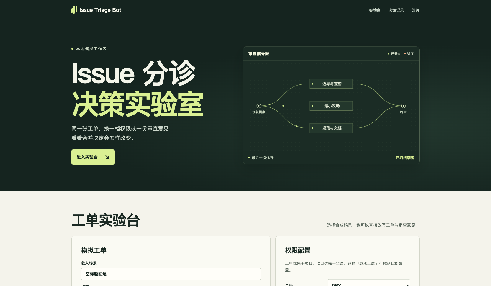

# Issue Triage Bot · 分诊决策实验室

用一张模拟 GitHub 工单，检查一条自动修复流水线何时应该停下来。你可以改写工单、调整权限、让某一路审查提出异议，然后沿决策记录追到实际生效的规则。

**[实验台入口文件](docs/index.html) · [阅读实测报告](docs/evals/refactor-1126-report.md) · [观看中文短片](docs/media/promo.mp4)**

[](docs/index.html)

## 本地打开

双击 `docs/index.html` 即可使用。实验台只加载仓库自带的脚本和样式，无需账户、凭据、联网或安装前端依赖。要通过 HTTP 访问，在仓库根目录运行以下命令，再打开终端提示的本地端口。

```sh
python3 -m http.server 8080 --bind 127.0.0.1 --directory docs
```

自托管时，将整个 `docs/` 放到静态文件服务的站点目录即可。GitHub Pages 可选择从 `main` 分支的 `/docs` 目录部署。页面使用相对资源路径，支持仓库子路径。

## 跟着一张工单观察决定

1. 首次打开会在 DRY 档运行「空标题回退」。决策记录里，发布评论与创建 PR 都是草稿。
2. 把项目档设为 FULL，再运行。同样的审查意见会得到「等待人工合并」，记录里能看到权限来自项目层。
3. 载入「审查意见分歧」。将这张工单设为 YOLO 并确认，运行后查看「最小改动」的返工意见。终审与合并均未进入。
4. 把该意见改为「通过」再运行。比较两份 JSON 的 `input.reviews.minimal`、`trace`、`plan.merge` 与 `outcome`。也可改成「待返回」，观察意见不齐时的停止位置。

表单和记录在当前页面的内存中保存，刷新会恢复初始场景。输入变化后点击「运行分诊」会生成新的快照。「导出 JSON」保存上一次已运行的记录。

## 权限与决策

内层设置优先，依次为工单、项目、全局。工单和项目均可选择继承。选择 YOLO 或撤掉覆盖后首次露出 YOLO，都要在界面确认。纯规则函数和 CLI 接收已经选定的配置。

| 生效档位 | 前置审核起点 | 评论、修复提案与 PR | 最终合并 |
| --- | --- | --- | --- |
| PAUSED | 停在当前模拟流程的起点 | 跳过 | 跳过 |
| DRY | 运行 | 写入草稿计划 | 人工 |
| SEMI | 运行 | 通过相应门禁后模拟发布 | 人工 |
| FULL | 运行 | 与 SEMI 相同 | 人工 |
| YOLO | 运行 | 通过相应门禁后模拟发布 | 三审齐备、全通过且终审通过后模拟合并 |

审核、构建、边界与兼容审查、最小改动审查、规范与文档审查、终审均是可编辑的模拟输入。任一路返工即退回修复，缺席则等待。前置审核退回仍可产生对应的标记与回复计划。所有档位都只计算动作，浏览器没有 GitHub 写入通道。

## 离线重放

浏览器和 Node.js 读取同一个确定性函数。Node.js 18 或更高版本可运行：

```sh
node replay.cjs examples/split-review.json
node replay.cjs examples/split-review.json > decision.json
node replay.cjs decision.json
node --test tests/engine.test.cjs
```

输入场景时，CLI 输出 `triage-lab/v1` 审计包；输入浏览器导出的完整审计包时，CLI 重新计算并逐字段比对。与记录不一致或输入无效会返回非零退出码。复算提供一致性检查，记录来源和作者身份需要另行验证。

| 字段 | 阅读方式 |
| --- | --- |
| `input` | 本次工单、三层档位、审核、构建、三审与终审的输入快照 |
| `effective` | 生效的权限以及来自哪个层级 |
| `trace` | 实际经过的环节、意见与理由；提前停止时下游环节不会出现在这里 |
| `plan` | 标记、发布提案、回复及合并各自落到草稿、模拟执行、人工或跳过 |
| `outcome` | 停止原因或最终处置 |

## 实测记录

私仓闸门在相同脚本的六组固定场景中，由 20/30 次符合预期变为 30/30。差异集中在等待者插队和墙钟跳变两项。将三层权限的 180 种合法输入逐个送入备份、重构和公开客户端，三者对生效档位的选择完全相同。[逐轮复测与原始记录](docs/evals/refactor-1126-report.md)

## 代码与评测范围

`docs/lab/engine.js` 定义公开的决策模型，`scenarios.js` 是合成工单，`ui.js` 将输入和运行快照呈现在页面上。CLI 与测试直接引用同一引擎。可以复制 `examples/split-review.json` 构造自己的对照场景。

本仓独立实现了可公开的客户端与本地体验。生产系统的模型调用、沙箱、并发调度、账户认证与发布服务由私有仓维护。实验台中的工单、审查结果与动作计划仅用于解释控制流，私仓并发评测的结论及适用条件见[重构报告](docs/evals/refactor-1126-report.md)。

## 许可

开源客户端代码使用 [MIT License](LICENSE)。短片中使用的个人声线仅作为已合成作品的一部分呈现。
