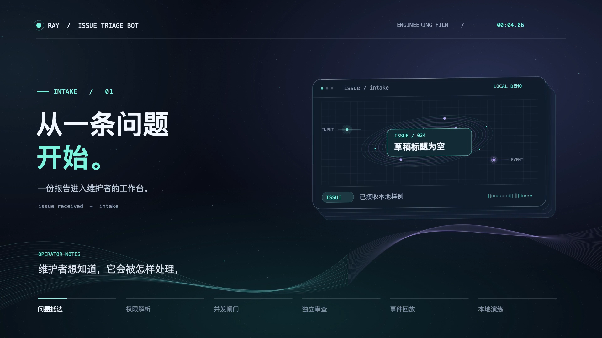
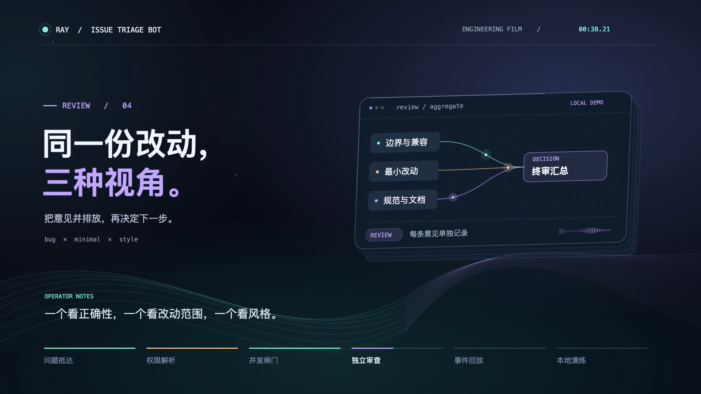
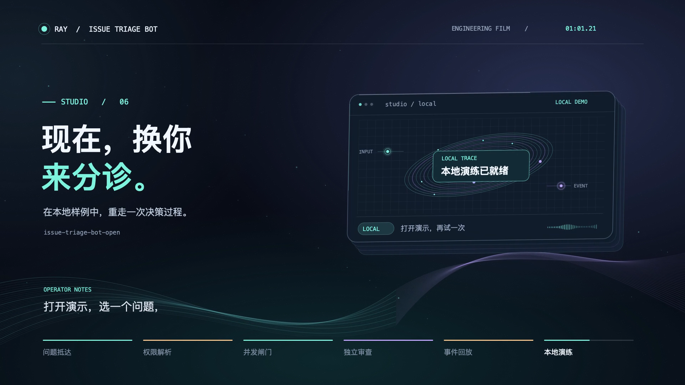
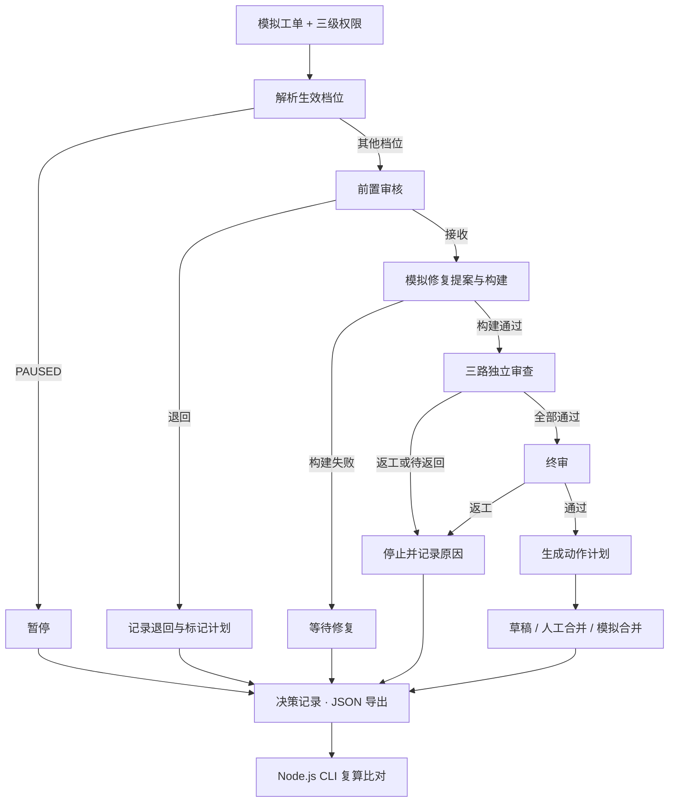

<div align="center">

# 🧭 Issue Triage Bot

### 让每一次自动化决定，都有迹可循。

**一张工单、三路审查、一份看得懂的决策记录。**

[](docs/lab/engine.js)
[](#离线重放)
[](LICENSE)
[](https://raymortwinkle.github.io/issue-triage-bot-open/)
[](https://raymortwinkle.github.io/issue-triage-bot-open/media/promo.mp4)
[](https://github.com/raymortwinkle/issue-triage-bot-open)

[✨ 在线交互体验站](https://raymortwinkle.github.io/issue-triage-bot-open/) · [🎬 观看中文宣传片](https://raymortwinkle.github.io/issue-triage-bot-open/media/promo.mp4) · [🚀 3 分钟上手](#-3-分钟本地跑起来) · [📊 实测对比](#-实测改善-before-vs-after) · [🏗️ 核心架构](#-工作原理)

</div>

> 一张 Issue 看似修好了，可如果一位审查者还在等结果，自动化流程该继续，还是停下来？

<div align="center">

[](https://raymortwinkle.github.io/issue-triage-bot-open/media/promo.mp4)

**▶ 点击封面观看中文宣传片** · [✨ 亲自打开交互体验站](https://raymortwinkle.github.io/issue-triage-bot-open/)

<video controls width="800" poster="docs/media/showcase-1.png" src="https://raymortwinkle.github.io/issue-triage-bot-open/media/promo.mp4">
  你的阅读环境不支持内嵌视频，请<a href="https://raymortwinkle.github.io/issue-triage-bot-open/media/promo.mp4">点击观看中文宣传片</a>。
</video>

<sub>如果 GitHub 页面没有显示播放器，可以直接点击封面或视频链接。下方画面为宣传片视觉帧。</sub>

</div>

<table>
  <tr>
    <td align="center" width="50%"><br /><strong>🔍 同一份改动，三种审查视角</strong></td>
    <td align="center" width="50%"><br /><strong>🧪 换你上场，亲手重走决策</strong></td>
  </tr>
</table>

## 💡 为什么做它？

🤔 自动化省下了重复劳动，但「为什么继续」和「为什么停下」往往藏在流程里。遇到意见分歧或权限变化时，我们需要的不只是一个结果，还需要能解释它的过程。

🧭 这个仓库提供一个**分诊决策实验台**：编辑模拟工单、权限和审查意见，运行后沿着记录看清每一步。它在浏览器中演算动作，**不会向 GitHub 发布评论、创建 PR 或合并代码**。

## ✨ 核心亮点

- 🎛️ **权限一眼看懂**：全局、项目、工单三级配置，工单覆盖项目，项目覆盖全局；五种档位让你比较草稿、人工合并与模拟自动合并。
- 🔀 **三路审查各有声音**：边界与兼容、最小改动、规范与文档分别给出意见；任一路返工或待返回，流程就停在相应位置。
- 🧾 **决定有据可查**：查看生效档位及来源、实际经过的环节、动作计划和停止原因；导出 JSON 留下运行快照。
- 🔁 **同一规则，离线重放**：浏览器与 Node.js CLI 共用确定性决策引擎，导出记录后可复算并逐字段比对。
- 🪶 **打开就能玩**：页面使用仓库自带的脚本与样式，无需账户、凭据或安装前端依赖。

## 🏗️ 工作原理

公开实验台接收的是**可编辑的模拟输入**：它展示决策控制流，而不调用生产模型或执行 GitHub 写入。



<details>
<summary><strong>🔐 五种档位分别会做什么？</strong></summary>

| 档位 | 实验台中的行为 |
| --- | --- |
| **PAUSED** | 在模拟流程起点暂停。 |
| **DRY** | 通过相应门禁后生成草稿计划，合并需人工处理。 |
| **SEMI / FULL** | 通过相应门禁后模拟发布，合并需人工处理。 |
| **YOLO** | 三路审查齐备且全部通过、终审通过后，计划中才会模拟合并；在界面启用时需要确认。 |

前置审核退回时仍可生成对应的标记与回复计划。所有档位只计算动作，不执行真实发布。

</details>

## 📊 实测改善 Before vs After

下面是**私有生产系统的单进程并发闸门**在固定脚本下的对照结果，不是公开实验台的性能数据。

| 固定场景 | 重构前 | 重构后 |
| --- | ---: | ---: |
| 等待者排队时，后来者未插队 | 0 / 5 | **5 / 5** |
| 模拟墙钟跳变时，等待预算仍按预期工作 | 0 / 5 | **5 / 5** |
| 六组场景中符合预期的观测总数 | 20 / 30 | **30 / 30** |
| 三级权限档位解析：180 种合法组合 | 180 / 180 | **180 / 180** |

<details>
<summary><strong>📐 看懂数字的边界与验证方法</strong></summary>

- 闸门六组场景各运行五轮；缩容、超时离队、扩容、异常退出四组在两版均为 5 / 5。插队与墙钟跳变是定向回归样本，旧调用在两版均最终完成，实验没有观测到永久饥饿或死锁。
- 测试运行于同一台 macOS arm64、Python 3.9.6 环境。它没有测量真实流量故障率、吞吐量、平均等待时间、尾延迟或模型质量。
- 权限组合比较了私仓备份、私仓重构与公开客户端，三者均为 180 / 180；这验证的是**档位解析兼容性**，不是完整生产流程的一致性。
- 私仓测试套件分别为 198 / 198 和 200 / 200，套件大小不同；发布相关测试使用离线命令替身，未执行真实发布。

查看[完整评测报告](docs/evals/refactor-1126-report.md)，其中包含实验条件、原始记录和复跑方法。

</details>

## 🚀 3 分钟本地跑起来

在仓库根目录运行 `python3 demo.py`，浏览器会打开 React 工作台。它使用本地样例完成修复、构建、三路审查和返工，五档回放均可离线体验。完整服务的入口为 `python3 bot.py`。重新构建前端可运行 `cd web-src && npm ci && npm run typecheck && npm run build`。

**最快方式：**下载或克隆仓库后，直接用浏览器打开 `docs/index.html`。页面无需联网。

也可以在仓库根目录通过本地 HTTP 服务打开：

```sh
python3 -m http.server 8080 --bind localhost --directory docs
```

浏览器访问 `http://localhost:8080/`，然后试试这组对照：

1. 载入「审查意见分歧」，运行分诊，看看「最小改动」要求返工时，流程在哪里停下。
2. 把这一路改为「通过」再运行，比较决策记录与动作计划；也可以改成「待返回」，观察等待状态。
3. 点击「导出 JSON」，保存上一次运行的输入与决策快照。页面刷新后会恢复初始场景。

### 离线重放

需要 Node.js 18 或更高版本。在仓库根目录运行：

```sh
node replay.cjs examples/split-review.json
node --test tests/engine.test.cjs
```

也可以将浏览器导出的审计包交给 `node replay.cjs <审计包路径>`。CLI 会重新计算并逐字段比对；不一致或输入无效时返回非零退出码。复算只能检查一致性，不能验证记录的来源或作者身份。

## 📚 延伸阅读 & 许可

- ✨ [在线交互体验站](https://raymortwinkle.github.io/issue-triage-bot-open/) · 🎬 [中文宣传片](https://raymortwinkle.github.io/issue-triage-bot-open/media/promo.mp4)
- 📊 [重构评测报告与原始记录](docs/evals/refactor-1126-report.md) · 🧩 [决策引擎](docs/lab/engine.js) · 🧪 [示例场景](examples/split-review.json)
- 👋 [Ray 的个人主页](https://raymor.top) · 📜 [MIT License](LICENSE)

公开仓包含 Python 分诊引擎、通用提示模板、React 控制台及本地演示数据。短片中的个人声线仅作为已合成作品的一部分呈现。

<div align="center">

**如果这个实验台给了你一点灵感，欢迎点个 ⭐ Star，让更多人看到它。**

</div>
